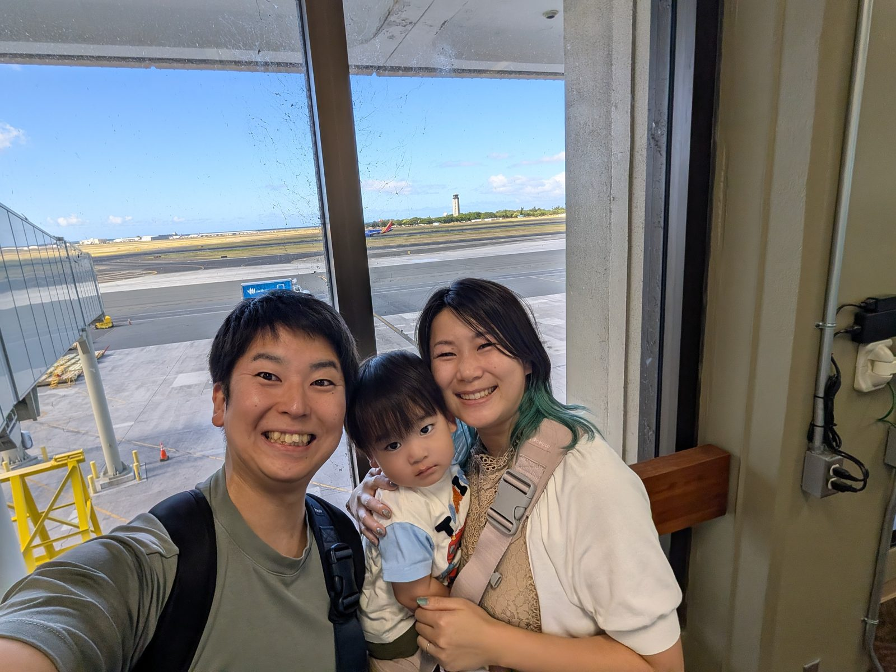
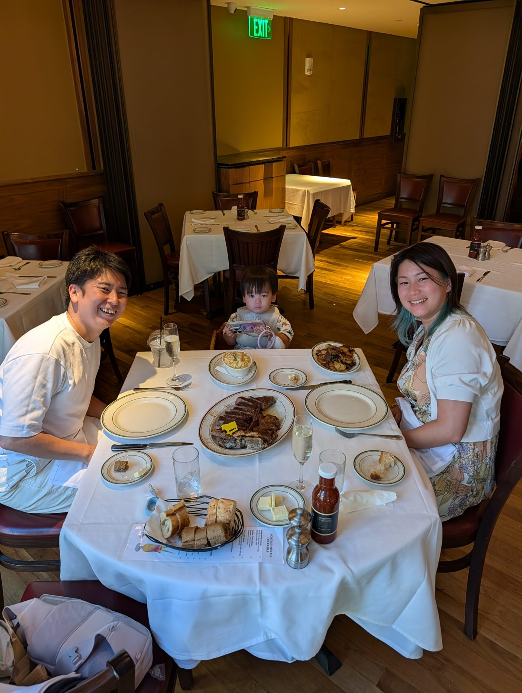
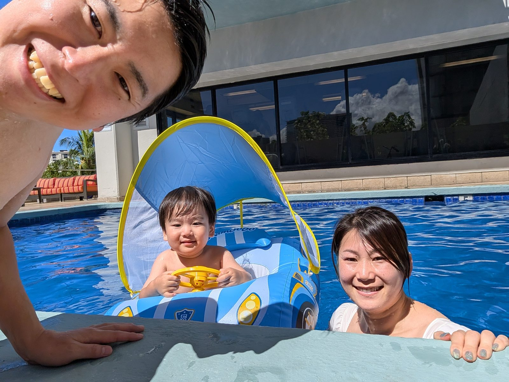
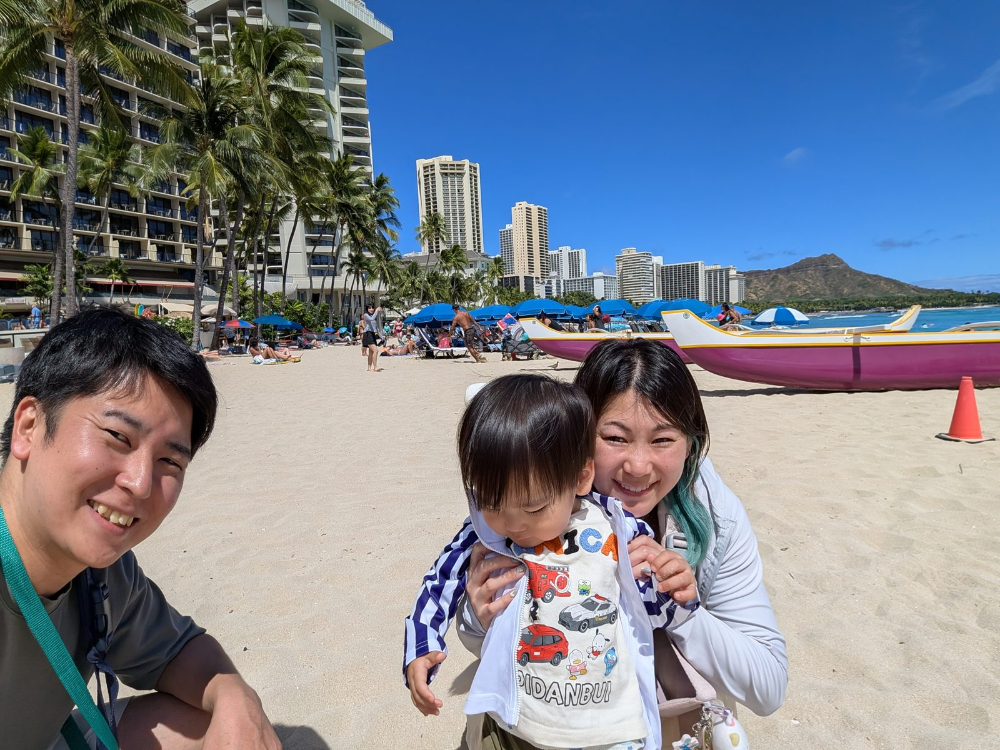
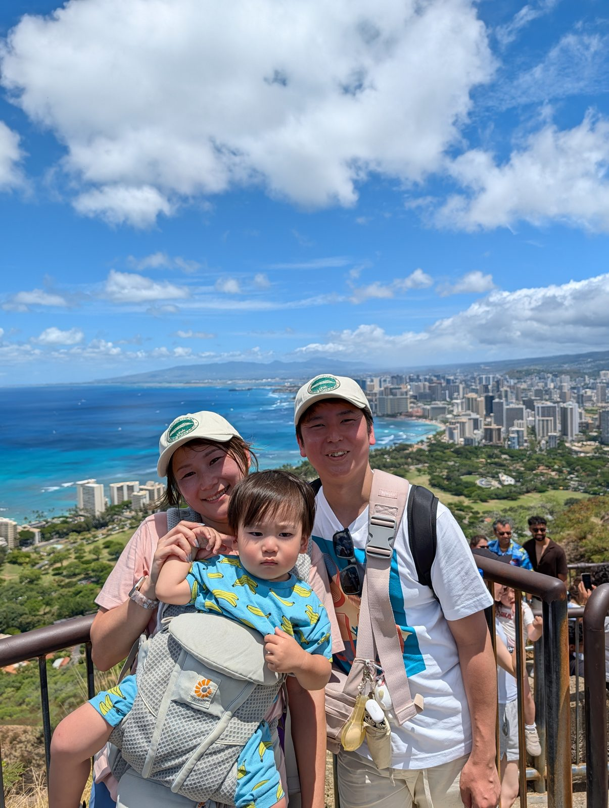

# 🌺 ハワイ（ホノルル）家族旅行

**2026.7.2（木）〜 7.5（日）** ／ 3泊4日・初めての子連れハワイ

| | |
|---|---|
| メンバー | パパ・ママ・こども |
| 宿泊 | ダブルツリー by ヒルトン アラナ・ワイキキ（3泊） |
| 往路 | NH184　7/2 成田T1 20:10 → ホノルル 8:45 |
| 復路 | NH181　7/5 ホノルルT2 13:00 → 成田 7/6 16:15 |

## 📷 思い出アルバム

ホノルル到着！

ウルフギャングのステーキ

ホテルのプールで

ワイキキビーチで

ダイアモンドヘッド登頂！

---

## 📌 予約済み

- 🥩 **ウルフギャング・ステーキ** — 7/3（金）17:30／3名／ロイヤル・ハワイアン・センター3F ✅
- 🌺 **パイナ・ワイキキ・ルアウ VIP** — 7/4（土）17:15チェックイン／ワイキキ・ビーチ・マリオット3F ✅
- ⛰️ **ダイアモンドヘッド** — 7/4（土）10:00入山／抱っこひも必須 ✅

---

## 🗺 4日間のながれ

### ✈ 出発日　錦糸町 → 成田空港 T1
⏱ 1時間19分 ／ 💴 1,099円 ／ 🔁 乗換1回

- **16:32** 錦糸町 発 — JR中央総武線各停・津田沼行／2番線
- **16:57** 船橋 着 → 🚶 徒歩4分（屋外乗換）
- **17:04** 京成船橋 発 — 京成本線特急・成田空港行／2番線
- **17:51** 成田空港（第1ターミナル）着 — 国際線チェックイン・保安検査へ
- **20:10** 🔴 **NH184 ホノルル行 出発 ✈** — 搭乗2〜3時間前に空港着が安心

### DAY 1　7/2（木）到着日
- **08:45** ホノルル空港 着 ✈ — 入国審査・荷物受取。子連れ列があれば利用
- **10:30** ホテルへ・荷物預け — チェックインは15:00〜
- **12:00** ザ・サンライズシャック（アサイー） — 2335 Kalākaua Ave
- **12:30** レナーズ・ベーカリー（マラサダ①） — 933 Kapahulu Ave。ワイキキから車・タクシーで10分ほど
- **午後** クヒオビーチで足だけ水遊び — 防波堤内で波が穏やか。無理せず早めに切上げ
- **18:30** 🔴 **アラモアナセンターでポケ丼（夕食）** 🚋ピンクライン — Foodland Farms Ala Moana。番号札を取って注文。〜22:00営業。⑨アクア・パームズ発18:12（32便）→アラモアナ着18:28
- **夜** 早めに就寝 — 時差調整。初日は詰め込まない

### DAY 2　7/3（金）のんびりデー
パンケーキ・プール・ステーキ・買い物

- **06:50** ホテル出発（徒歩5〜7分）
- **07:00** アロハ・キッチン（パンケーキ） — 432 Ena Rd。行列必至のため開店と同時が安全
- **09:30** ホテルへ戻る
- **10:00** ホテルプールでひと泳ぎ — 1時間ほど
- **11:00** ホテルで休憩・シャワー — お昼寝含めゆったり
- **14:00** アラモアナセンター（お買い物）🚋ピンクライン — 〜16:00。⑨アクア・パームズ発13:42（14便）→アラモアナ着13:58。妻のJCB提示で無料
- **16:28** ⑩アラモアナセンター発 🚋（24便） — ホテルには戻らず①方面へ直行。16:48頃到着見込み
- **17:30** 🔴 **ウルフギャング・ステーキ【確定】** — 3名・ハイチェア手配済み
- **19:00** ロイヤル・ハワイアン・センターでお買い物 — ウルフギャングと同じ建物

### DAY 3　7/4（土）アクティブデー
KCCマーケット・ダイアモンドヘッド・買い物・ルアウ

- **08:25** ホテル出発 — Kalakaua Ave + Ena Rd バス停へ徒歩4分
- **08:29** TheBus 2番系統 乗車 — HOLOカードで乗車（$3、5歳以下無料）
- **08:51頃** KCCファーマーズマーケット付近で下車 — 徒歩4分
- **09:15** KCCファーマーズマーケット（食べ歩き） — 土曜限定7:30-11:00。1〜2品つまむ程度
- **09:50** ダイアモンドヘッドへ — すぐ隣、徒歩圏内
- **10:00** 🔴 **ダイアモンドヘッド 入山【予約確定済み】** — 往復1.6mile・60〜90分。ベビーカー不可、抱っこひもで。日陰なし、水分・休憩こまめに
- **11:30** 下山 — 着替え・タオルがあると快適
- **11:42** TheBus 200番系統 — Alohea Ave + Pokole St発。5駅・5分
- **12:00** レナーズ・ベーカリー（マラサダ②） — Kaimuki Ave+Kapahulu Ave下車、徒歩2分
- **13:02** TheBus 13番系統 — LILIHA-Puunui行き、15駅・20分
- **13:26** ホテルへ戻りシャワー — Kalakaua Ave+Pau St下車、徒歩3分
- **14:30** ロイヤル・ハワイアン・センターでお買い物 — 〜16:30
- **16:30** 身支度 — ルアウは屋外なので薄手の羽織があると安心
- **17:15** 🔴 **パイナ・ワイキキ・ルアウ VIP【確定】** — プライムリブビュッフェ＋カクテル2杯、ステージ至近席。〜20:00
- **20:30** 🔴 **独立記念日 花火（10分間）** — ハレクラニ／モアナ・サーフライダー沖合

### DAY 4　7/5（日）帰国日
- **07:30** フォート・デルーシー・ビーチで足だけ海 — 15〜20分だけ
- **08:00** トロピカル・トライブ（アサイー③） — 1778 Ala Moana Blvd。ホテルのすぐ横
- **09:00** ホテルへ戻り荷物整理
- **10:00** チェックアウト・ホテル出発 — 早めに空港へ
- **13:00** 🔴 **NH181 成田行 出発 ✈** — ホノルル 第2ターミナル発
- **7/6 16:15** 成田空港 着（+1日）

---

## 🍽 食べたいものチェック

- [x] ウルフギャングのステーキ — DAY2（予約済み）
- [ ] アサイーボウル①（ザ・サンライズシャック）— DAY1
- [ ] マラサダ①（レナーズ・ベーカリー）— DAY1
- [ ] ポケ丼（Foodland Farms Ala Moana）— DAY1
- [ ] パンケーキ（アロハ・キッチン）— DAY2
- [ ] マラサダ②（レナーズ・ベーカリー）— DAY3
- [ ] アサイーボウル③（トロピカル・トライブ）— DAY4

## 🛋 市内ラウンジ（クレカ特典）

**① ホノルルラウンジ by JTB**（ワイキキショッピングプラザ 2F・〜18時）
- 対象：エポス（ゴールド含む）／三井住友（受付で要確認）
- 同伴者も無料・手荷物預かり・ベビーカー貸出・ドリンク・Wi-Fi

**② 楽天カード ハワイラウンジ**（アラモアナセンター エヴァウィング3F ／ インターナショナルマーケットプレイス 1F）
- 対象：楽天カード（通常でOK・現物提示）。同伴者5名まで無料

## 🚋 ワイキキトロリー無料特典

- ピンクライン（アラモアナライン）が JCB カード提示で無料
- 妻のJCBで「ファミリー」と伝えると本人＋大人1名＋11歳以下の子供2名まで無料
- 最寄り乗り場は **⑨アクア・パームズ・ワイキキ**（⑪イリカイ待ちはほぼ1周するので避ける）

---

## 🎒 荷物リスト

### 1. 公共交通メインの優先アイテム
- [ ] 軽いサブバッグ（両手が空くもの）
- [ ] 折りたたみエコバッグ
- [ ] 小さめの水筒／ボトル
- [ ] ウェットティッシュ（多め）
- [ ] ジップ袋 大中小
- [ ] 薄手の羽織（冷房対策）
- [ ] ベビーカー＋レインカバー（持参する場合）
- [ ] 抱っこひも
- [ ] 迷子対策の連絡先カード

### 2. ビーチ・水遊び
- [ ] 浮き輪（足入れタイプ／アームリング）
- [ ] 水遊び用おむつ（スイミングパンツ）
- [ ] マリンシューズ（子供用）
- [ ] ラッシュガード
- [ ] 濡れた水着入れの防水袋
- [ ] リーフセーフ日焼け止め（ハワイは一部成分が規制対象）

### 3. 洗面・食事のこまごま
- [ ] 歯ブラシ（大人＋子供用）・歯磨き粉
- [ ] スキンケア／保湿クリーム
- [ ] ストローマグ／コップ
- [ ] 食事エプロン・スタイ
- [ ] 使い慣れたおやつ・ベビーフード少し

### 4. 健康・書類・通信
- [ ] 体温計・冷却シート
- [ ] 母子手帳・海外旅行保険の控え
- [ ] クレジットカード／少額の現金（ドル）
- [ ] eSIM か Wi-Fi

### 5. 手元に置くもの（機内・移動バッグ）
- [ ] おむつ 6枚
- [ ] おしりふき
- [ ] 着替え 2セット
- [ ] タオル小 1枚
- [ ] おやつ・飲み物
- [ ] お気に入りおもちゃ 2〜3個
- [ ] 薬（解熱剤など最低限）
- [ ] 充電セット（ケーブル＋モバイルバッテリー）

### 6. 預けてOK
- [ ] 残りのおむつ（合計20〜24枚。現地アラモアナでも買える）
- [ ] 携帯洗濯機＋洗剤少量
- [ ] 水着・ビーチ用品
- [ ] 洗面セットの予備

### 🔑 預ける直前チェック
- [ ] パスポート・財布・スマホ
- [ ] 充電ケーブル最低1本
- [ ] 子ども：おむつ2〜3枚＋おしりふき＋着替え1セット＋飲み物／おやつ
- [ ] 薬
- [ ] 羽織 1枚

---

## 💡 お得メモ

- **TheBus＋HOLOカード**：5歳以下は同乗1名無料。1日上限$8.50。2時間以内の乗継無料。カード$2はABCストアで
- **ダブルツリーの焼きたてクッキー**：チェックイン時に無料
- **ABCストア**：水・軽食・日焼け止め・オムツはホテルより安い
- **エポスの海外旅行保険**：家族・子供分の扱いは出発前に要確認
- **アラモアナの無料フラ・音楽ショー**、**ヒルトンの金曜花火**

---

Mahalo! 家族みんなで、いい思い出を 🌺　｜　[← 旅の一覧へ](README.md)
